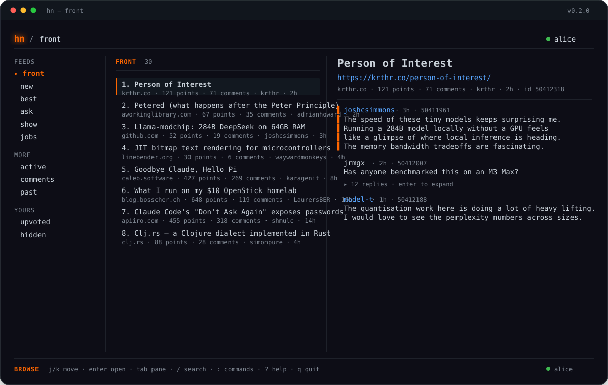

<div align="center">
  
  <h1>hn</h1>
  <p><strong>Hacker News in your terminal.</strong></p>
  <p>An interactive full-screen browser, a scriptable CLI, and a first-class JSON interface for agents — for <a href="https://news.ycombinator.com">news.ycombinator.com</a>.</p>
  <p><a href="https://hn.vivekkaushal.com/"><strong>Website</strong></a> · <a href="AGENTS.md">Agent guide</a> · <a href="llms.txt">llms.txt</a></p>

  <p>
    <a href="https://github.com/kaushalvivek/hn-cli/actions/workflows/ci.yml"></a>
    <a href="https://github.com/kaushalvivek/hn-cli/releases/latest"></a>
    <a href="https://github.com/kaushalvivek/hn-cli/blob/main/LICENSE"></a>
    
    
    <a href="https://github.com/kaushalvivek/homebrew-tap"></a>
  </p>
</div>



## Install

`hn` is a single static binary on Linux and a universal binary on macOS.

### Linux

Native packages install `hn`, its man page, license, and README. The only runtime dependency is `ca-certificates`.

#### Debian / Ubuntu

```bash
VERSION=0.4.2
curl -LO "https://github.com/kaushalvivek/hn-cli/releases/download/v${VERSION}/hn_${VERSION}_amd64.deb"
sudo apt install "./hn_${VERSION}_amd64.deb"
```

Use `arm64` instead of `amd64` on ARM servers.

#### Fedora / RHEL / openSUSE

```bash
VERSION=0.4.2
curl -LO "https://github.com/kaushalvivek/hn-cli/releases/download/v${VERSION}/hn-${VERSION}-1.x86_64.rpm"
sudo dnf install "./hn-${VERSION}-1.x86_64.rpm"
# openSUSE: sudo zypper install "./hn-${VERSION}-1.x86_64.rpm"
```

Use `aarch64` instead of `x86_64` on ARM servers.

#### Arch Linux

```bash
VERSION=0.4.2
curl -LO "https://github.com/kaushalvivek/hn-cli/releases/download/v${VERSION}/hn-${VERSION}-1-x86_64.pkg.tar.zst"
sudo pacman -U "./hn-${VERSION}-1-x86_64.pkg.tar.zst"
```

Use `aarch64` instead of `x86_64` on ARM servers.

#### Alpine Linux

```bash
VERSION=0.4.2
curl -LO "https://github.com/kaushalvivek/hn-cli/releases/download/v${VERSION}/hn_${VERSION}_x86_64.apk"
sudo apk add --allow-untrusted "./hn_${VERSION}_x86_64.apk"
```

Use `aarch64` instead of `x86_64` on ARM servers.

#### Any Linux distribution, no root

```bash
curl -fsSL https://raw.githubusercontent.com/kaushalvivek/hn-cli/main/install.sh | sh
```

Detects x86_64 or aarch64 and installs to `~/.local/bin`. Override with `HN_INSTALL_DIR` and pin a release with `HN_VERSION`:

```bash
HN_VERSION=0.4.2 HN_INSTALL_DIR="$HOME/bin" sh install.sh
```

All Linux release binaries are statically linked against musl and run across distributions. They need CA certificates for HTTPS; install `ca-certificates` on minimal systems.

### macOS

Homebrew is the simplest option:

```bash
brew install kaushalvivek/tap/hn
```

> Homebrew 7 may ask you to trust a third-party tap on first use. If prompted, run `brew trust kaushalvivek/tap`.

Or use the same install script as Linux:

```bash
curl -fsSL https://raw.githubusercontent.com/kaushalvivek/hn-cli/main/install.sh | sh
```

### Direct download

| Platform | Archive | Native packages |
| --- | --- | --- |
| macOS Apple Silicon + Intel | `hn-macos-universal.tar.gz` | — |
| Linux x86_64 | `hn-linux-x86_64.tar.gz` | `.deb`, `.rpm`, `.pkg.tar.zst`, `.apk` |
| Linux aarch64 | `hn-linux-aarch64.tar.gz` | `.deb`, `.rpm`, `.pkg.tar.zst`, `.apk` |

```bash
VERSION=0.4.2
ASSET=hn-linux-x86_64.tar.gz   # or hn-macos-universal.tar.gz
curl -LO "https://github.com/kaushalvivek/hn-cli/releases/download/v${VERSION}/${ASSET}"
curl -LO "https://github.com/kaushalvivek/hn-cli/releases/download/v${VERSION}/checksums.txt"
# Linux:
sha256sum -c checksums.txt --ignore-missing
# macOS:
# grep " ${ASSET}$" checksums.txt | shasum -a 256 -c -
tar -xzf "$ASSET"
mkdir -p ~/.local/bin
install -m 755 hn ~/.local/bin/hn
```

### Cargo

```bash
cargo install --locked --git https://github.com/kaushalvivek/hn-cli
```

Requires Rust 1.88+.

### From source

```bash
git clone https://github.com/kaushalvivek/hn-cli.git
cd hn-cli
make install
```

`make install` builds with Cargo and installs to `/usr/local/bin` by default. Use `PREFIX=~/.local make install` for a user-local install.

### Updating

- **Linux packages:** download and install the new package with the same command.
- **Install script:** re-run it.
- **Homebrew:** `brew upgrade hn`.

### Uninstalling

```bash
sudo apt remove hn        # Debian / Ubuntu
sudo dnf remove hn        # Fedora / RHEL
sudo pacman -Rns hn       # Arch
sudo apk del hn           # Alpine
rm -f ~/.local/bin/hn     # install-script installs
brew uninstall hn         # Homebrew
rm -rf ~/.config/hn       # optional: remove session and drafts
```

## Quick start

```bash
hn                          # open the interactive browser
hn browse --feed new        # start on a specific feed
hn front --limit 10         # line-oriented output
hn thread 8863              # story + comment tree
hn search "rust async" --sort date
hn login                    # authenticated actions
hn whoami
```

Run `hn --help` or `hn <command> --help` for the full surface.

## Agents

Every read command supports `--json` (or `HN_JSON=1`). The CLI is designed to be discovered without reading the source:

```bash
hn capabilities                       # machine-readable command map, schemas, env vars
hn front --limit 5 --json             # structured feed
hn item 8863 --json
hn thread 8863 --json
hn search "sqlite" --type story --limit 10 --json
hn user pg --json
```

```bash
hn front --limit 10 --json \
  | jq -r '.entries[] | "\(.score)\t\(.title)\t\(.id)"'
```

Errors are JSON on stderr with `--json`:

```json
{"ok": false, "error": {"code": "rate_limited", "message": "Hacker News rate-limited the request"}}
```

Exit code is `0` on success and `1` on error. Read commands make no writes and need no account. Authenticated writes are never implicit.

Agent guides: [`AGENTS.md`](AGENTS.md) and [`llms.txt`](llms.txt).

## The interactive browser

`hn` opens a full-screen terminal app with a feed sidebar, story list, detail pane, and threaded comments.

- Keyboard-first, with mouse scrolling
- Threaded comments with collapse/expand
- Search, command palette, help overlay, login modal, and toasts
- Inline composer with context, drafts, retry-safe errors, and immediate in-thread replies
- Vote, favorite, hide, flag, comment, edit, delete, and submit without leaving the terminal
- Feed loading from HN's HTML, with Firebase and Algolia adapters underneath

| Key | Action |
| --- | --- |
| `j` / `k`, `↑` / `↓` | Move |
| `g` / `G` | Top / bottom |
| `Enter` / `l` | Open |
| `Tab` | Next pane |
| `Esc` / `h` | Back / close |
| `Space` | Expand or collapse replies |
| `/` | Search |
| `:` or `Ctrl-P` | Command palette |
| `r` | Refresh |
| `o` / `y` | Open in browser / copy URL |
| `v` / `V` / `u` | Upvote / downvote / unvote |
| `f` / `F` | Favorite / unfavorite |
| `H` / `U` | Hide / unhide |
| `!` | Flag |
| `c` / `e` / `d` | Comment / edit / delete |
| `s` | Submit a story (title, link, text) |
| `L` | Log in |
| `?` | Keyboard help |
| `q` / `Ctrl-C` | Quit |

Drafts are saved to `~/.config/hn/drafts.json` on `Esc`, on `Ctrl-C`, and on failed posts. Reopening the same composer restores them.

## Scriptable CLI

The line-oriented commands are designed for pipes, scripts, and quick one-off reads.

| Command | Description |
| --- | --- |
| `hn front`, `hn new`, `hn best` | Core feeds |
| `hn ask`, `hn show`, `hn jobs` | Ask HN, Show HN, and jobs |
| `hn active`, `hn comments` | Active threads and latest comments |
| `hn noob-stories`, `hn noob-comments` | New low-karma submissions and comments |
| `hn past [YYYY-MM-DD]` | Past front page |
| `hn from <domain>` | Submissions from one site |
| `hn item <id>` | One item |
| `hn thread <id>` | Story or comment tree |
| `hn context <comment-id>` | Comment plus its ancestor chain |
| `hn user <username>` | Profile and activity |
| `hn search <query>` | Search stories and comments |
| `hn leaders`, `hn updates` | Leaders and recent changes |
| `hn upvoted`, `hn hidden` | Your upvoted and hidden items |

Pagination is `--limit N --page N` on feed and activity commands.

### Authenticated actions

```bash
hn login
hn vote 8863
hn submit
hn submit --title "..." --url https://example.com
hn submit --title "..." --text "A text post"
hn comment 8863 --text "..."
hn comment 8863                 # context + $EDITOR, saved as a draft on failure
hn comment 8863 --use-draft     # resume a saved draft
hn edit 8863 --text "..."
hn delete 8863 --yes
hn favorite 8863
hn hide 8863
hn flag 8863 --reason spam
hn unflag 8863
hn logout
```

#### Submitting a story

In the browser, press `s` to open a real submission form:

- **Title** is required (80 characters max).
- **Link** is optional. Fill it for a link post. A bare domain like `example.com/post` is normalized to `https://example.com/post`.
- **Text** is optional. Leave Link empty and write text for a text post.

`Tab` / `Shift-Tab` move between fields, `Ctrl-S` submits, and `Esc` saves the whole form as a draft. Failed submissions are kept as drafts too.

From the CLI, `hn submit` walks you through the same fields: it prompts for a title and link, and opens `$VISUAL`/`$EDITOR` when you leave the link empty. Non-interactive use is explicit:

```bash
hn submit --title "..." --url https://example.com
hn submit --title "..." --text "A text post"
hn submit --use-draft          # resume a saved submission
```

When `hn comment` runs in a terminal without `--text`, it fetches the parent, prints the author and a quoted excerpt, opens `$VISUAL`/`$EDITOR`, and saves the text as a draft if posting fails. `hn drafts` lists drafts; `hn drafts --clear` removes them.

Hacker News has **no official write API**. Authenticated actions use the site's HTML forms, session cookie, and per-page tokens. The session file is stored at `~/.config/hn/session.json` with `0600` permissions; passwords are never persisted. Because these interfaces are unofficial, write actions can break if HN changes its markup.

## Configuration

| Variable | Purpose |
| --- | --- |
| `HN_CONFIG_DIR` | Directory for session and drafts (default `~/.config/hn`) |
| `HN_PASSWORD` | Password for non-interactive `hn login` (prefer `--password-stdin`) |
| `HN_JSON` | Same as `--json`. `1` and `true` enable JSON; `0` and `false` disable it; an empty value is unset |
| `NO_COLOR` | Disable color in line-oriented output when set to any non-empty value. An empty value is unset |
| `VISUAL` / `EDITOR` | Editor for interactive comment and edit |
| `HN_SITE_URL` | Override the HN HTML base URL (testing/self-hosting) |
| `HN_FIREBASE_URL` | Override the Firebase base URL (testing) |
| `HN_ALGOLIA_URL` | Override the Algolia base URL (testing) |

## Architecture

`hn` is a Rust crate with a pure domain model and narrow transport adapters:

| Module | Responsibility |
| --- | --- |
| `src/domain.rs` | Domain entities, value objects, feeds, threads, and operations. No networking. |
| `src/http.rs` | `HttpTransport` abstraction and the `reqwest` implementation. |
| `src/firebase.rs` | Firebase items, users, feeds, and updates. |
| `src/algolia.rs` | Search and item-tree fast path. |
| `src/site.rs` | news.ycombinator.com HTML, session, login, and write actions. |
| `src/client.rs` | Composed client and thread fallback. |
| `src/cli.rs` | `clap` command surface, human output, and JSON output. |
| `src/tui.rs` | `ratatui` interactive browser. |
| `src/drafts.rs` | Shared on-disk drafts for the CLI and TUI. |

The domain model is documented in [`docs/DomainModel.md`](docs/DomainModel.md). Release instructions live in [`docs/RELEASING.md`](docs/RELEASING.md).

## Development

```bash
cargo test
cargo run -- --limit 5
cargo run -- browse
cargo build --release
```

The test suite covers the domain model, Firebase and Algolia decoding, HN HTML parsing, session handling, drafts, and CLI behaviour. Tests never use a real account: authenticated flows are exercised against a local fake HN server.

## Contributing

Contributions are welcome. Start with [`CONTRIBUTING.md`](CONTRIBUTING.md). For security issues, use [`SECURITY.md`](SECURITY.md).

Questions, ideas, or feedback: [vivekkaushal.com/talk](https://vivekkaushal.com/talk)

## License

[MIT](LICENSE) © 2026 Kaushal Vivek

`hn` is not affiliated with Y Combinator or Hacker News. Thanks to Hacker News for the site and APIs, Algolia for search, and the Rust open-source ecosystem.
